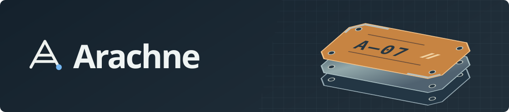

# Arachne · 阿拉克涅

[简体中文](README.md) · **English**



Arachne is a local 3D texturing workbench. Build up bare metal, paint and wear on a model, edit markings in a layered 2D texture, then light and render the result in the same project. The model keeps its original UVs, and the material and texture layers stay editable.

[Run from source](#run-from-source) · [Desktop builds](#desktop-builds) · [Workbench guide (Chinese)](README.md#工作台快捷入口)

## Texture an access panel

| Step | In the workbench |
| --- | --- |
| **Start with a mesh** | Open a GLB with UVs and choose the material to paint. To try the tools first, start with the built-in cube. |
| **Build the finish** | Use fill layers for the metal and topcoat. Set their color, metallic and roughness values independently, then use an edge-wear mask to expose the metal along raised edges. |
| **Add markings** | Place a panel number and a stripe on separate layers in a 4K texture document. Use selections and masks to confine them. Bind the document to a material channel and return to it when a marking needs to move. |
| **Inspect and deliver** | Press `C` in the 3D view to inspect channels and `M` to return to the full material. Set up the lighting and camera for a PNG or OpenEXR render, or deliver the GLB, PBR maps and editable project. |

## Run from source

Clone the repository, then run the commands for your platform from its root.

### Apple Silicon macOS

The documented environment is macOS 14 or later, Node.js 24 and Python 3.12.

```sh
npm --prefix workbench/console ci
python3.12 -m venv .venv
. .venv/bin/activate
python -m pip install -r workbench/console/requirements.txt
export ARACHNE_PYTHON="$PWD/.venv/bin/python"
npm run seed:demo
npm start
```

### Windows x64

Install Node.js 24 and Python 3.12 x64 with the Python launcher or Python on your PATH. Open PowerShell in the repository root.

```powershell
npm.cmd run setup:win
npm.cmd run start:win
```

Open the [local workbench](http://127.0.0.1:8766/) and choose the demo or import your own GLB. The default project directory is `workbench/console/data`. For final renders from a source checkout, install the render browser with `npm --prefix workbench/console exec -- playwright-core install --only-shell chromium`.

## Desktop builds

The project also builds an Apple Silicon Mac app and a Windows x64 installer or portable ZIP. The desktop packages bundle the runtimes used by the workbench. See the [Mac build instructions (Chinese)](README.md#构建-mac-应用) or the [Windows packaging instructions (Chinese)](README.md#windows-x64-桌面版).

## License

Arachne’s own source code is licensed under [GPL-3.0-only](LICENSE). Third-party components and fonts retain their [respective licenses](THIRD_PARTY.md).
