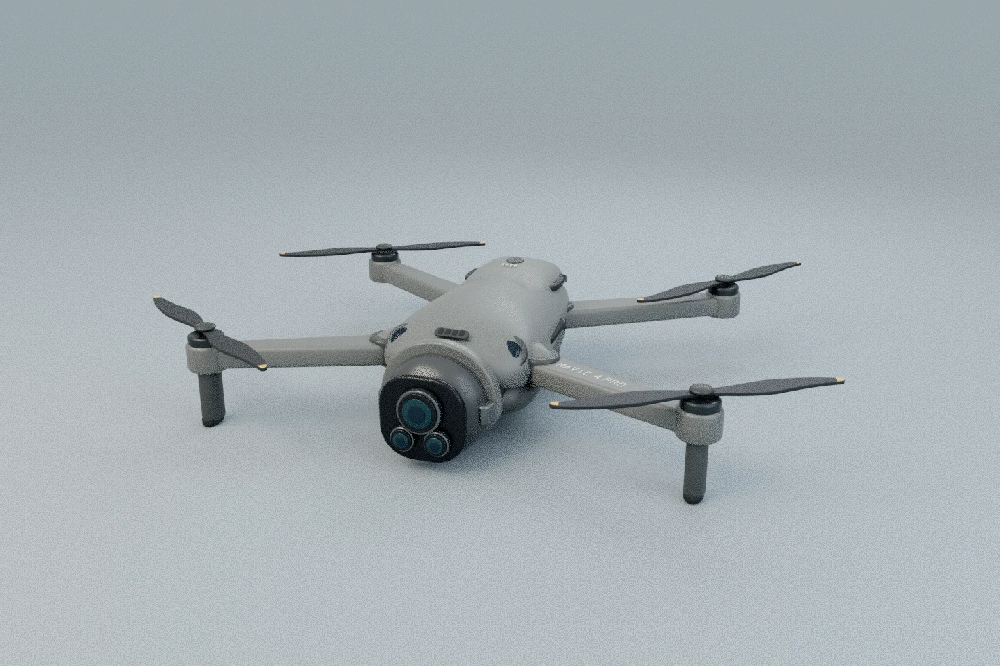
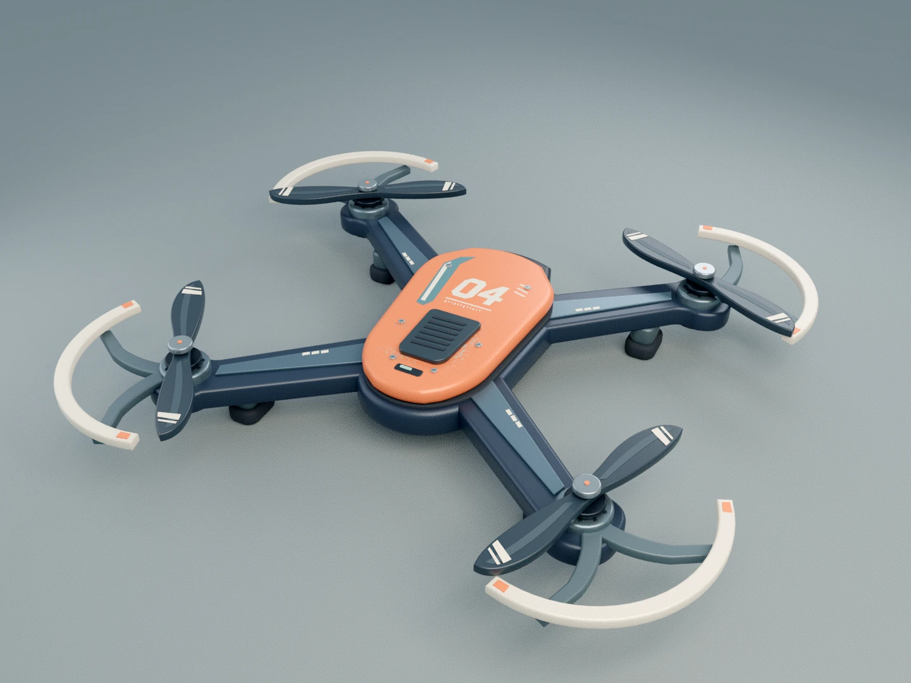
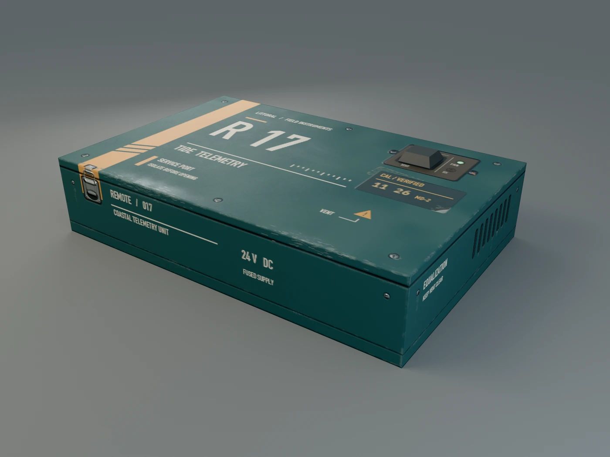

<div align="center">


# Arachne

[](package.json)
[](#apple-silicon-macos)
[](#windows-x64)
[](#run-from-source)
[](#run-from-source)
[](LICENSE)

A local workspace for texturing 3D models

[简体中文](README.md) · [Run from source](#run-from-source) · [Report an issue](https://github.com/AvroraCL/arachne/issues)

</div>

Paint textures, edit materials and inspect the model in the same project. For an aircraft livery, for example, you can lay out numbers and stripes on the 2D canvas, then turn the model to see how the stripes wrap around the fuselage. If a number needs to move, its layer is still editable.



**DJI Mavic 4 Pro exterior study, revised.** Lofted fuselage sections, a shared three-aperture camera bezel, coated glass, matte optical wells and separate motor finishes. The project includes an editable shell roughness mask and two saved cameras. Geometry was estimated from public photographs. [Product reference](https://www.dji.com/mavic-4-pro) · [Camera close-up](docs/images/mavic-4-pro-optics.webp) · [Lens recess revision](docs/images/mavic-4-pro-optics-revision.webp) · [Model source](examples/mavic-4-pro-studio) · [Editable project ZIP](https://raw.githubusercontent.com/AvroraCL/arachne/main/examples/mavic-4-pro-studio.zip)



**Tidewing 04** started as an original SVG drawing. Arachne extruded the shell, arms, blades and guards into separate meshes. Three editable material layers add polished grips, dried salt around the service hatch and tool scratches. [Hatch detail](docs/images/tidewing-04-hatch.webp) · [Bevel shading before and after](docs/images/tidewing-04-bevel.webp)

Load the SVG in the New Project dialog. Select a part to set its elevation, thickness and bevel, then rotate the assembly to inspect the fit. Save the SVG settings to revisit the profiles, or open the project ZIP to continue painting. [Modeling profiles (SVG)](https://raw.githubusercontent.com/AvroraCL/arachne/main/examples/tidewing-04.svg) · [Editable project (ZIP)](https://raw.githubusercontent.com/AvroraCL/arachne/main/examples/tidewing-04.zip)



*R17 tide station, painted and rendered on the bundled example model. Worn paint exposes aluminum beside the latch. The side vents reveal a salt screen, and the calibration date remains editable.*

Detail views · [Latch and lid wear](docs/images/r17-latch.webp) · [Calibration foil and self-test button](docs/images/r17-calibration.webp) · [Probe and data connectors](docs/images/r17-connectors.webp)

Open the project from the File menu to edit the finish, calibration date and saved shots. [Download the R17 sample project (7 MB)](https://raw.githubusercontent.com/AvroraCL/arachne/main/examples/tide-station-r17.zip)

## What you can make

- **Layered textures.** Combine images, shapes and gradients on a 4K canvas. Use selections and masks to trim an edge, then bind the texture document to a material channel.
- **Surface finishes.** Adjust color, metallic and roughness by layer so paint and bare metal catch the light differently. Reveal metal along raised edges with a wear mask, and save a layer group as a reusable smart material.
- **Renders and editable projects.** Inspect individual channels in the viewport, set the camera and lights, and render a PNG or OpenEXR. To hand off the work, package the model, PBR textures and editable project together.

## Try it

Arachne runs on Apple Silicon Macs and Windows x64. You can also use a browser to access the workbench running on your computer.

Drag a GLB into the workbench and choose a material to paint. If you don’t have a model handy, start a paint project from the File menu and choose the cube. Add a fill layer, adjust its roughness and rotate the view to see how the highlight changes.

## Run from source

Clone the repository, then run the commands for your platform from its root.

### Apple Silicon macOS

The documented environment is macOS 14 or later, Node.js 24 and Python 3.12.

```sh
npm --prefix workbench/console ci
python3.12 -m venv .venv
. .venv/bin/activate
python -m pip install -r workbench/console/requirements.txt
export ARACHNE_PYTHON="$PWD/.venv/bin/python"
npm run seed:demo
npm start
```

### Windows x64

Install Node.js 24 and Python 3.12 x64 with the Python launcher or Python on your PATH. Open PowerShell in the repository root.

```powershell
npm.cmd run setup:win
npm.cmd run start:win
```

Open the [local workbench](http://127.0.0.1:8766/) and choose the demo or import your own GLB. The default project directory is `workbench/console/data`. For final renders from a source checkout, install the render browser with `npm --prefix workbench/console exec -- playwright-core install --only-shell chromium`.

## Desktop builds

The project also builds an Apple Silicon Mac app and a Windows x64 installer or portable ZIP. The desktop packages bundle the runtimes used by the workbench. See the [Mac build instructions (Chinese)](WORKBENCH.zh-CN.md#构建-mac-应用) or the [Windows packaging instructions (Chinese)](WORKBENCH.zh-CN.md#windows-x64-桌面版).

## License

Arachne’s own source code is licensed under [GPL-3.0-only](LICENSE). Third-party components and fonts retain their [respective licenses](THIRD_PARTY.md).
