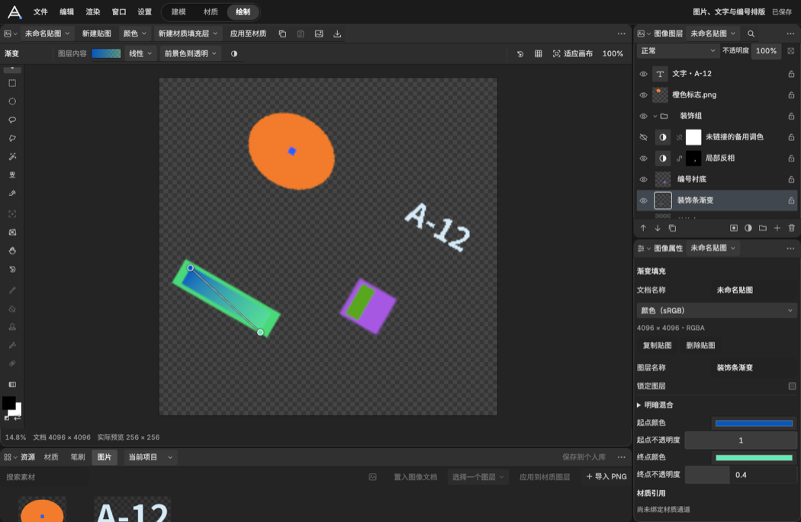

# Arachne

**A local 3D texturing workbench for artists working on models and liveries.** Edit a mesh, build PBR materials, paint layered textures and render the result in one project. Available as an Apple Silicon Mac app, a Windows x64 desktop app or a workbench served locally in your browser.

[简体中文](README.md) · **[Run from source](#run-from-source)** · [Desktop builds](#desktop-builds) · [Report an issue](https://github.com/AvroraCL/arachne/issues)



The screenshot shows the drawing workspace in use. The number, graphic and stripe sit on separate layers. Drag the stripe’s gradient handles on the canvas or change either color in the properties panel.

## A typical texturing workflow

1. **Prepare the mesh.** Import a GLB, glTF or OBJ model and select the material to paint. You can also start with a built-in plane, cube or sphere.
2. **Build the surface.** Use fill layers for base color, metallic and roughness. Reveal the underlying material with painted masks, edge wear and surface noise. Save a layer group as a smart material to reuse it.
3. **Paint the texture.** Combine images, shapes, gradients and adjustments in a layered 4K document. Use selections and masks to place a marking, bind the document to a material channel, and return to edit it later.
4. **Inspect and deliver.** Check individual channels on the model, set up lights and a camera, and render a PNG or floating-point OpenEXR. Package the model, PBR maps and editable project together.

## Run from source

Clone the repository, then run the commands for your platform from its root.

### Apple Silicon macOS

The documented environment is macOS 14 or later, Node.js 24 and Python 3.12.

```sh
npm --prefix workbench/console ci
python3.12 -m venv .venv
. .venv/bin/activate
python -m pip install -r workbench/console/requirements.txt
export ARACHNE_PYTHON="$PWD/.venv/bin/python"
npm run seed:demo
npm start
```

### Windows x64

Install Node.js 24 and Python 3.12 x64 with the Python launcher or Python on your PATH. Open PowerShell in the repository root.

```powershell
npm.cmd run setup:win
npm.cmd run start:win
```

Open the [local workbench](http://127.0.0.1:8766/) and choose the demo or import your own GLB. The default project directory is `workbench/console/data`. For final renders from a source checkout, install the render browser with `npm --prefix workbench/console exec -- playwright-core install --only-shell chromium`.

## Desktop builds

The project also builds an Apple Silicon Mac app and a Windows x64 installer or portable ZIP. The desktop packages bundle the runtimes used by the workbench. See the [Mac build instructions (Chinese)](README.md#构建-mac-应用) or the [Windows packaging instructions (Chinese)](README.md#windows-x64-桌面版).

## License

Arachne’s own source code is licensed under [GPL-3.0-only](LICENSE). Third-party components and fonts retain their [respective licenses](THIRD_PARTY.md).
