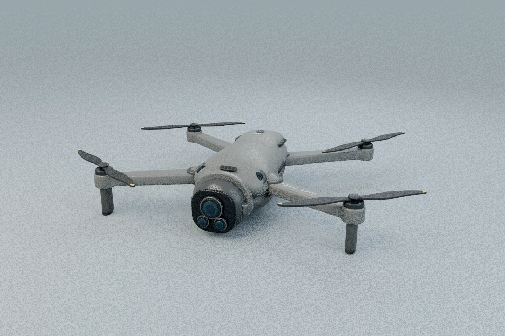
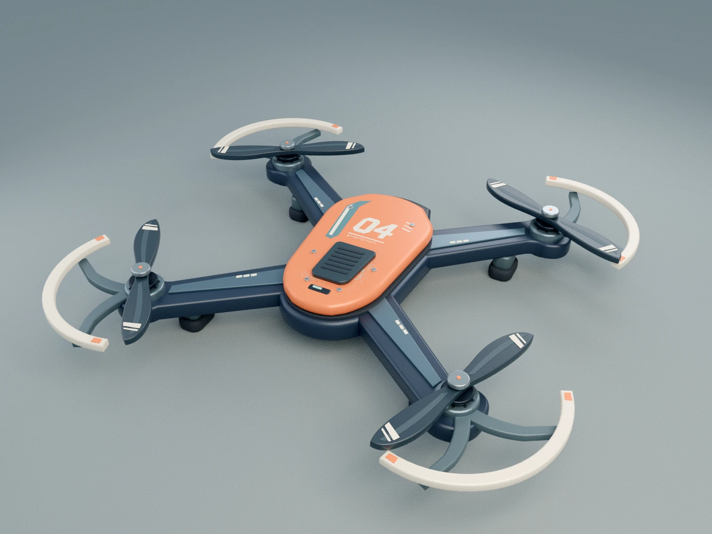
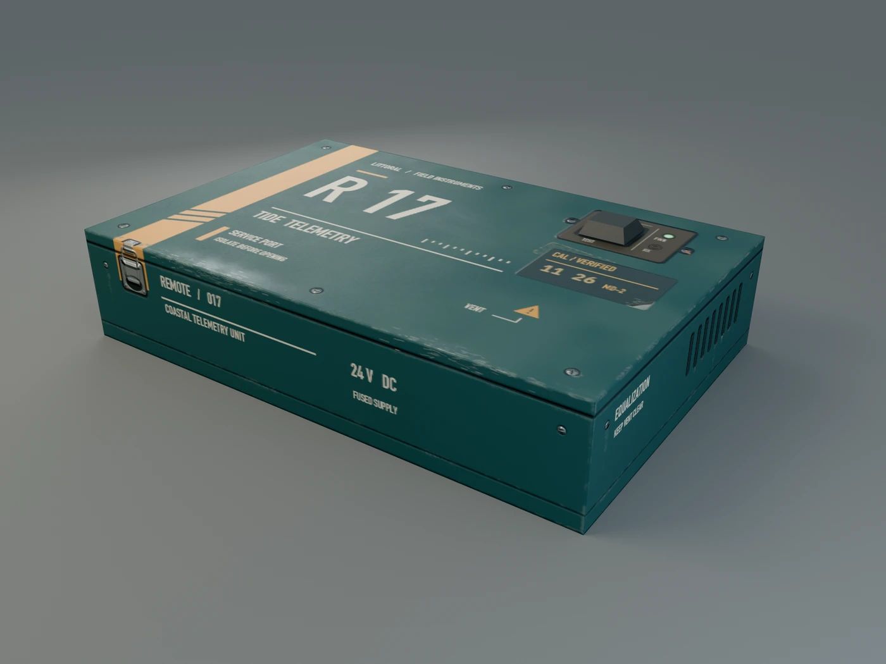

# 阿拉克涅 · Arachne

为三维模型制作涂装的本地工作台

[English](README.en.md) · [使用手册](WORKBENCH.zh-CN.md) · [反馈问题](https://github.com/AvroraCL/arachne/issues)

阿拉克涅让你在同一个工程里画贴图、调材质、看模型。比如做一套机身涂装，你可以在二维画布上摆好编号和色带，再转动模型，看看色带绕过曲面时有没有错位。要改编号，只需回到它所在的图层。

**DJI Mavic 4 Pro 外观习作（精修版）**。机身按纵向截面放样，三摄共用开孔面框，镜片、消光内壁和金属电机罩分别赋材质。工程带有可编辑的机壳粗糙度蒙版、整机和云台两个机位。几何依据公开照片估形。 [官方外观参考](https://www.dji.com/mavic-4-pro) · [镜组特写](docs/images/mavic-4-pro-optics.webp) · [侧盖与主摄凹槽返工对照](docs/images/mavic-4-pro-modeled-update.webp) · [建模源稿](examples/mavic-4-pro-studio) · [可编辑工程 ZIP](https://raw.githubusercontent.com/AvroraCL/arachne/main/examples/mavic-4-pro-studio.zip)

**汐羽 04** 从一张原创 SVG 轮廓图起步。工作台把机壳、机臂、桨叶和护框挤出成独立网格，再用三个材质层画出握持区的亮面、散热盖边的盐迹和开盖细划。[查看机盖细节](docs/images/tidewing-04-hatch.webp) · [同机位倒角修正对照（左前右后）](docs/images/tidewing-04-bevel.webp)

用「文件 → 新建工程 → 选择模型」载入 SVG。选择部件，调整底部高度、厚度和倒角，转动试装预览后创建工程；「保存轮廓设置」可保留挤出参数。要继续修改涂装，请用「文件 → 打开涂装 ZIP」。[建模轮廓 SVG](https://raw.githubusercontent.com/AvroraCL/arachne/main/examples/tidewing-04.svg) · [可编辑工程 ZIP](https://raw.githubusercontent.com/AvroraCL/arachne/main/examples/tidewing-04.zip)

*R17 潮位遥测接线盒，使用工作台自带的示例模型制作。搭扣附近露出铝底，侧面均压孔后有挡盐网，校准箔上的日期仍可编辑。*

细节图　[搭扣与开盖磨损](docs/images/r17-latch.webp) · [校准箔与自检键](docs/images/r17-calibration.webp) · [探头与数据接线口](docs/images/r17-connectors.webp)

用「文件 → 打开涂装 ZIP」可继续编辑这件作品。[下载 R17 示例工程（7 MB）](https://raw.githubusercontent.com/AvroraCL/arachne/main/examples/tide-station-r17.zip)

## 可以用它做什么

- **画贴图。** 在 4K 画布上组合图片、形状和渐变，用选区和蒙版修边，再把图像文档绑定到模型的材质通道。
- **做表面材质。** 分层调节颜色、金属度和粗糙度，让漆面和裸露的金属对光线有不同的反应。用磨损蒙版露出凸边的底材，把满意的图层组合存为智能材质。
- **出图和交付。** 在三维视口检查各个通道，调好相机与灯光，输出 PNG 或 OpenEXR。需要交给别人继续做时，可以把模型、PBR 贴图和可编辑工程一起打包。

## 第一次使用

工作台支持 Apple Silicon Mac 和 Windows x64，也可以在浏览器里连接本机运行的服务。从源码启动，请选对应平台的说明：[macOS](WORKBENCH.zh-CN.md#apple-silicon-macos) · [Windows](WORKBENCH.zh-CN.md#windows-x64-开发环境)。

打开工作台后，把自己的 GLB 拖进窗口，选择要涂装的材质。如果手边没有模型，在「文件 → 新建涂装工程」里选一个立方体就能开始。先给它加一层颜色，再拖动粗糙度、转一转视角，就能看到表面高光的变化。

[完整操作与构建指南](WORKBENCH.zh-CN.md) · [GPL-3.0-only 许可证](LICENSE) · [第三方组件](THIRD_PARTY.md)
